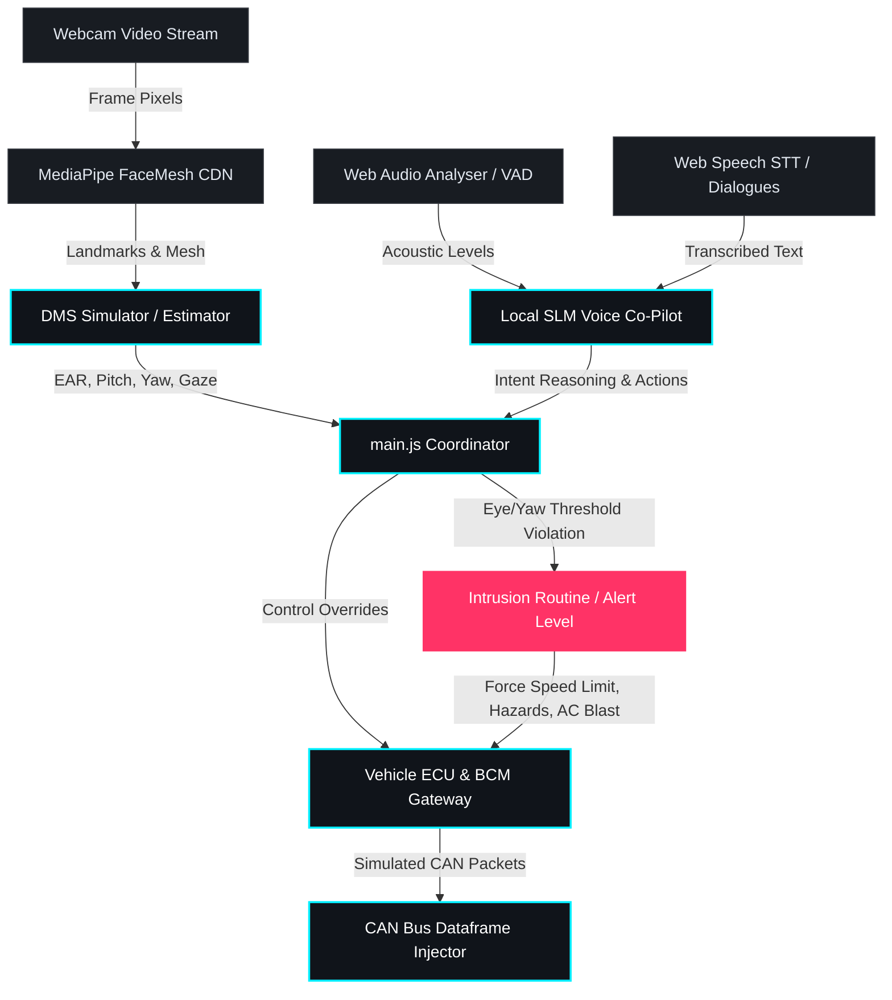
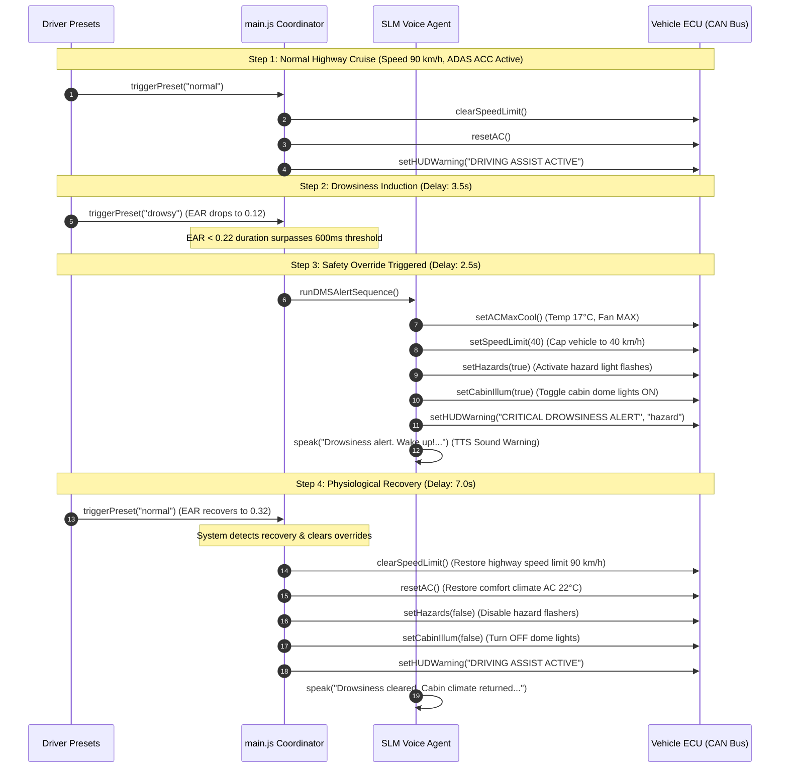

# DriveGuard Edge - Active Safety Agent Proof of Concept (POC)

[](#)
[](#)
[](#)

**DriveGuard Edge** is a hybrid, offline Driver Monitoring System (DMS) and Local SLM (Small Language Model) Voice Co-Pilot designed for modern automotive edge processors (e.g., i.MX8 Edge SoC). This Proof of Concept (POC) demonstrates a real-time active safety system that monitors driver attention metrics, interprets voice commands locally, and executes vehicle control overrides via simulated CAN bus message frames during safety-critical events.

---

## 📂 File Directory Structure

```
DriveGuard-Edge/
├── index.html            # Main dashboard UI entrypoint (Tailwind CSS, CDN dependencies)
├── package.json          # Node devDependencies & scripts (Vite config)
├── package-lock.json     # Lock file for dependencies
├── README.md             # Project documentation (This file)
├── public/               # Static assets & public resources
└── src/
    ├── main.js           # Central system coordinator, render loops, & threshold triggers
    ├── style.css         # Theme colors, glassmorphism panel styles, and keyframe animations
    ├── dmsSim.js         # Driver Monitoring System (MediaPipe Face Mesh / 3D wireframe fallback)
    ├── slmAgent.js       # Offline SLM agent simulator, dialogue logs, & STT/TTS engine
    └── vehicleInterface.js # Vehicle state, speedometer gauge, BCM, & CAN bus controller
```

---

## 🛠️ System Architecture & Technical Subsystems



### 1. Computer Vision Driver Monitoring System (DMS) ([dmsSim.js](file:///c:/Users/shaly/Documents/GitHub/DriveGuard-Edge/src/dmsSim.js))
The DMS parses visual frames to estimate physiological indicators of driver distraction and fatigue.
* **Dual Rendering Modes**: 
  * **Live Computer Vision Mode**: Integrates the webcam stream with browser-based MediaPipe Face Mesh libraries, tracking face geometry in real-time.
  * **Procedural 3D Wireframe Fallback**: Renders an interactive 3D matrix wireframe head model based on trigonometric interpolations (`slerp`) of Pitch, Yaw, and Roll.
* **Eye Aspect Ratio (EAR)**: Computes eye openness by calculating relative distances of vertical and horizontal eyelids coordinates.
  * *Drowsiness Threshold*: Triggers safety sequences if EAR drops below `0.22` for more than **0.6 seconds** (600ms).
* **Head Pose Estimation**: Evaluates head Yaw (left/right rotation) and Pitch (up/down tilt).
  * *Windshield Gaze Distraction*: Yaw values exceeding `±20°` for more than **1.0 second** activate warnings to return attention to the road vectors.
* **Phone Distraction Check**: Detects signature postures (Head Pitch tilted down `> 15°` combined with gaze directed down `DOWN (PHONE)`) for more than **0.8 seconds**.
* **Quantized Mock Inference**: Simulates low-power integer quantization (`INT8`) suitable for edge-compute hardware.

### 2. Local SLM Voice Co-Pilot ([slmAgent.js](file:///c:/Users/shaly/Documents/GitHub/DriveGuard-Edge/src/slmAgent.js))
A voice-controlled dialogue system that processes driver commands locally and displays real-time agent scratchpad logs.
* **Reasoning Scratchpad**: Simulates the Chain-of-Thought (`CoT`) thought trace of a quantized **Phi-3-mini-4k-instruct (INT4 - 1.92GB)** offline LLM.
* **Dual-Mode Voice Recognition**:
  * **Speech-to-Text (STT)**: Utilizes the browser's native `SpeechRecognition` API (falling back to an offline VAD selection panel when offline).
  * **Web Audio Analyser**: Runs a Voice Activity Detector (VAD) loop on raw microphone input streams. It analyzes PCM acoustic waveforms, drives dashboard feedback bars, and triggers actions after detecting **1.2 seconds** of silence.
* **Local Text-to-Speech (TTS)**: Utters spoken audio warnings utilizing `window.speechSynthesis` with optimized parameters (Emergency rates: `1.35` speed, `0.9` pitch; Comfort rates: `1.05` speed, `1.1` pitch).
* **Deterministic Safety Guardrails**: Hardcoded checks block commands targeting safety critical features. Any command containing block keywords (`disable`, `turn off`, `ignore`, `deactivate`, `bypass`) targeting dangerous domains (`brake`, `steering`, `crash`, `safety`, `dms`, `speed limit`) are rejected, returning a `0x403 FORBIDDEN` refusal alert.

### 3. Vehicle Control Interface & CAN Bus Gateway ([vehicleInterface.js](file:///c:/Users/shaly/Documents/GitHub/DriveGuard-Edge/src/vehicleInterface.js))
Simulates vehicle ECUs (Engine Control Units) and a Body Control Module (BCM) linked to a 500 Kbps Controller Area Network (CAN) bus.
* **Speedometer Gauge**: Renders an interactive circular SVG gauge that updates progressively and turns red when active speed caps are imposed.
* **HVAC Climate Unit**: Tracks target temp variables, regulates fan speeds (`AUTO`, `LOW`, `MED`, `MAX`), and spins the fan graphics at rate-matching speeds (e.g. fast spinning during critical cooling blasts).
* **Accessory Control Toggles**: Switches state and packs BCM status bytes for Hazard lights, Cabin Illumination (dome lights), and ADAS Adaptive Cruise Control (ACC).
* **CAN Dataframe Injector**: Renders a scrolling dataframe of mock CAN packets. It streams background traffic signals (e.g., wheel speeds, yaw steering angles, brake pressures) mixed with high-priority overrides highlighted in red.

---

## 📡 CAN Bus Controller Message Reference

The simulated CAN controller handles packet transactions based on standard hexadecimal frame layouts:

| CAN ID | Transmitter | DLC | Description & Translation Payload |
|:---|:---|:---|:---|
| **`0x0A2`** | Wheel Speed Unit | 6 | Streams raw rotation velocity (`WHEEL_SPEED: <speed> km/h`) |
| **`0x1B4`** | Steering Angle ECU | 4 | Streams steering rack deviations (`STEERING_ANGLE: <degrees>°`) |
| **`0x3F6`** | Brake Pressure Unit | 5 | Streams system braking cylinder pressure (`BRAKE_PSI: <pressure>`) |
| **`0x2D1`** | Transmission ECU | 8 | Standard background transmission telemetry noise |
| **`0x4E8`** | Infotainment Unit | 8 | Audio volume settings and media sync traffic |
| **`0x101`** | ADAS / Engine ECU | 8 | Speed limit override controller. Byte 0 specifies cap limit, Byte 1 acts as the control override flag. |
| **`0x203`** | HVAC Controller | 8 | Cabin climate setpoint frame. Byte 0 = temperature target (Multiplied by 10), Byte 1 = fan speed level. |
| **`0x30A`** | Body Control (BCM) | 8 | Cabin accessories control. Byte 0 is a bitmask of lamp indicators: `0x01` (Hazards), `0x02` (Cabin Lights), `0x04` (ADAS ACC). |
| **`0x0F2`** | DMS Safety Gateway | 8 | Heads-Up Display warning levels. Byte 0 specifies warning intensity (100 = Critical), Byte 1 activates flashing HUD signals. |

---

## 🛠️ Development & Command Reference

The application is built on top of modern JavaScript modules bundled and served using **Vite**.

| Command | Action |
|:---|:---|
| **`npm install`** | Installs devDependencies (Vite) |
| **`npm run dev`** | Spins up local development server (typically at `http://localhost:5173`) |
| **`npm run build`** | Bundles production-ready static assets inside `dist/` |
| **`npm run preview`** | Statically serves the production build folder locally for verification |

---

## 🚨 Active Safety Simulation Sequences

You can trigger and experiment with safety sequences using the following interactive controls on the dashboard:

### 1. Manual Slider Overrides
Located in the **"Manual Telemetry Adjustments"** accordion under Column 1. Drag the inputs to simulate sensor feedback:
* Adjust the **EAR Closeness** slider to drop below `0.22` (simulating closed eyelids).
* Drag the **Head Yaw** slider past `±20°` (simulating gazing away towards side windows).
* Drag the **Head Pitch** slider down (simulating downward distraction posture).

### 2. Spoken Intent Presets
Click the shortcut buttons under Column 2 to mock voice transcription events:
* **"Make it 18°C"**: Sets HVAC cabin system parameters, packing and sending CAN ID `0x203`.
* **"Nearest rest stop?"**: Accesses local pre-cached spatial databases, returning nearest waypoint suggestions.
* **"Disable brakes"**: Triggers deterministic guardrail refuse logic (blocks execution, outputs refusal speech, and registers a blocked log).

### 3. Automated Emergency Test Scenario
Click the primary button in the footer to execute a full highway driving simulation sequence:


